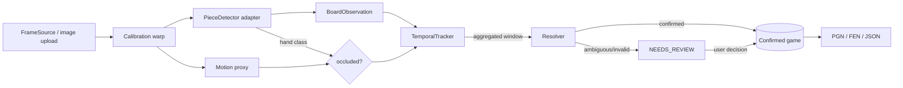

# Design: chess-vision (release 1)

## 1. Layout

```
backend/
  chessvision/
    config.py              settings from CHESSVISION_* env vars
    core/                  pure logic, no I/O, no model imports
      coords.py            canonical board frame, square <-> pixel
      calibration.py       corner validation, homography, warp, camera direction
      observation.py       labels, Detection, SquareObservation, BoardObservation, builders
      metadata.py          PositionMetadata + provenance, FEN assembly/validation
      notation.py          SAN/UCI/coords/English/flags from python-chess moves
      resolver.py          legal-successor scoring -> no_move/confirmed/ambiguous/invalid
      temporal.py          video state machine
      game.py              confirmed game record, replay + revalidation, PGN
    inference/
      base.py              PieceDetector / CornerDetector protocols, ModelUnavailable
      registry.py          manifest loading, availability checks, lazy loading
      yolo.py              optional Ultralytics adapter (imported only if installed)
      motion.py            frame-difference occlusion proxy (degraded mode)
    media/
      images.py            upload validation, decode
      video.py             probe, FrameSource protocol, VideoFileFrameSource
    storage/db.py          SQLite schema + repository functions
    jobs/worker.py         single background worker thread, cancel, review pause
    jobs/video_job.py      per-frame pipeline: warp -> detect -> observe -> track -> persist
    api/                   FastAPI app, schemas, routers
  models/models.json       model manifest (weights themselves are git-ignored)
  scripts/                 fetch_reference_weights.py, verify_real_inference.py
  tests/
frontend/                  Vite + React + TypeScript
```

Dependency direction: `api -> jobs -> (inference, media, storage) -> core`. `core` imports only numpy, OpenCV (calibration math) and python-chess.



## 2. Conventions (defined once in `core/coords.py`)

- Squares use python-chess indices: `square = file + 8 * rank`, file 0..7 = a..h, rank 0..7 = 1..8.
- Canonical warped board of side `S` pixels (default 640): `a8` at (0,0), `h8` at (S,0), `h1` at (S,S), `a1` at (0,S). Pixel (x, y) maps to `file = floor(8x/S)`, `rank = 7 - floor(8y/S)`. Points outside [0, S) map to no square (never clamped).
- Image points are (x, y) with y downward.

## 3. Calibration

Input: four image points clicked clockwise (UI asks to start at the top-left of the image) and `a1_index` (0..3), the clicked point that is the a1 corner.

Clockwise from a1 as seen from above, the board corners are a1, a8, h8, h1. So `src[j] = clicked[(a1_index + j) % 4]` for chess corners `[a1, a8, h8, h1]` and `dst = [(0,S), (0,0), (S,0), (S,S)]`.

Validation (all reported, not only the first):
- 4 finite points; each within the image expanded by 5%.
- Shoelace sum > 0 in y-down coordinates (clockwise on screen).
- Convex, no self-intersection (cross products of consecutive edges share a sign).
- Area >= 1% of image area; no edge shorter than 1% of the image diagonal.

Camera direction (`camera_dir`, a unit vector in warped space from the board centre toward the camera) is used only for piece anchoring (section 4). It comes from the `camera_side` calibration field:
- `auto` (default): `estimate_camera_dir` uses perspective foreshortening. The board edge nearest the camera appears longest in the image. With image lengths of the rank-1, rank-8, a-file and h-file edges, `dy = (rank1 - rank8) / (rank1 + rank8)` and `dx = (h - a) / (h + a)`; the result is `normalize(dx, dy)`, or `None` when its length is below 0.04 (near top-down or already-rectified image).
- `none`: no direction (anchor at box centre). Use for top-down or pre-warped images.
- `rank1` / `rank8` / `afile` / `hfile`: the user states which board side faces the camera.

The calibration records `camera_dir_source` (estimated, none detected, or user) so the report shows where the value came from.

Superseded design (kept for the record): the first implementation projected the image bottom-centre through the homography. On pre-warped or tightly cropped images that point lands just outside the board on an arbitrary side, which shifted anchors by up to half a square and failed the real-model test (23/28 squares agreeing on one board). The foreshortening estimate plus the user override replaced it.

## 4. Observations

Labels: `"empty"` plus FEN symbols `P N B R Q K p n b r q k`. Detector outputs also include `"hand"`.

`Detection{label, conf, box(x1,y1,x2,y2)}` in warped pixels.

Anchor (per model, `AnchorSpec`):
- `fraction`: point `(x1 + fx*w, y1 + fy*h)`.
- `toward_camera` (default): from box centre move `strength` (default 0.5) of the half-extent toward `camera_dir`; falls back to box centre when `camera_dir` is `None`.

Square distribution (`build_observation`):
- No detection anchored in square: `p(empty) = empty_prior` (0.92), remainder spread uniformly over the 12 pieces.
- Detections present: piece mass `M = min(0.98, max conf)` split across detected labels in proportion to confidence; `(1-M)/2` to empty; `(1-M)/2` spread over the other piece labels.
- Occluded: square centre inside any hand box dilated by 10%, or the whole frame flagged occluded. Occluded squares keep `probs = None` and are skipped by scoring.
- Uncertain flags: `top_prob < uncertain_threshold` (0.6), `multiple_detections`, `near_edge` (anchor within `edge_margin` = 12% of a square from its border), `occluded`.
- Detections whose anchor falls outside the board are reported in `warnings` and ignored.

Manual observations (board editor, user corrections) give the chosen label `p = 0.999` and are tagged `source = "manual"`.

## 5. Position metadata and FEN (`core/metadata.py`)

`PositionMetadata{side_to_move, castling, en_passant, halfmove, fullmove, provenance: {field: source}}` with sources `user | trusted_fen | standard_start | derived_from_game | assumed_default`.

- Single image, no user input: `w - - 0 1`, every field `assumed_default`. The API returns `assumptions: [...]` strings shown in the UI.
- Castling rights are only ever taken from the user or a trusted FEN. If the user claims a right that the placement makes impossible (king or rook not on its home square), validation fails with a message; rights are never added or silently removed.
- `board.status()` problems (missing king, pawns on back rank, side not to move in check, etc.) are reported as `position_issues`. Comparison and games require a valid position.

## 6. Resolver (`core/resolver.py`)

Candidates: `None` (no move) and every `board.legal_moves` entry (python-chess lists each promotion piece separately).

For each candidate: expected placement after the move; `score = sum over non-occluded squares of log(max(p[expected], 1e-6))`; `changed = squares whose content differs from before`; `confident_mismatches = squares where observed top != expected and top_prob >= uncertain_threshold`.

Decision (best = highest score):
1. `best.confident_mismatches > 0` -> `invalid` ("observation contradicts every single-move explanation").
2. Any square in `best.changed` occluded -> `ambiguous`.
3. Any square in `best.changed` with `top_prob < uncertain_threshold` -> `ambiguous`.
4. `best.score - second.score < margin_threshold` (default 3.0 nats) -> `ambiguous`.
5. Otherwise `no_move` if best is no move, else `confirmed`.

Output: status, reason, ranked top-N candidates with score, margin to best, changed squares, mismatches, and move descriptions.

## 7. Temporal tracker (`core/temporal.py`)

Input per sampled frame: `FrameEvidence{t, observation | None, occluded: bool, occlusion_source}`. A frame is treated as a dropout (like occlusion) when the observation is missing or when the count of non-empty top labels falls below 50% of the confirmed piece count.

| State | Event | Next |
|---|---|---|
| STABLE | occluded/dropout | OCCLUDED_OR_MOVING |
| STABLE | observation deviates from confirmed placement (confident square differs) and signature not ignored | SETTLING (window = [frame]) |
| OCCLUDED_OR_MOVING | clear frame | SETTLING (window = [frame]) |
| SETTLING | occluded/dropout | OCCLUDED_OR_MOVING (window cleared) |
| SETTLING | signature changed | SETTLING (window restarted) |
| SETTLING | `t_last - t_first >= stable_seconds` and `len >= min_frames` | VALIDATING |
| VALIDATING | resolver `no_move` | STABLE |
| VALIDATING | resolver `confirmed` | STABLE, emit `move` |
| VALIDATING | resolver `ambiguous`/`invalid` | NEEDS_REVIEW, emit `review` |
| NEEDS_REVIEW | `resolve_review(move)` | STABLE (move committed, provenance user) |
| NEEDS_REVIEW | `resolve_review(None)` | STABLE, signature added to ignore set |

Signature = tuple of top labels for non-occluded squares. Window aggregation = per-square mean probabilities; a square is occluded in the aggregate if occluded in more than half the window. The emitted move carries `t_settled = t_first` and `t_accepted = t_last`. The tracker never mutates the confirmed board except through a confirmed resolver result or `resolve_review`.

## 8. Confirmed game (`core/game.py`)

`GameRecord{start_fen, start_metadata, entries: [MoveEntry{uci, provenance, evidence?, t_settled?, t_accepted?, thumbnail?}]}`.

`replay(start, entries, resolver)`: walk entries; an entry with evidence is re-resolved from the current position and kept only if the result is `confirmed` with the same UCI; an entry without evidence is kept if legal. The first failure and everything after it become `detached`. Edit/delete endpoints call this and persist kept entries as `active`, detached as `detached`.

PGN via `chess.pgn`; `SetUp "1"` + `FEN` headers when the start is not standard; video timestamps as comments (`{board settled at 12.40 s}`).

## 9. Inference adapter

`models/models.json` entries: `id, task (piece_detector | board_corners), file, runtime ("ultralytics"), imgsz, conf, input ("warped_board" | "raw_image"), class_map, has_hand_class, anchor, license, source_url, sha256 (optional)`.

`registry.status()` per model: `available | missing_file | runtime_not_installed | load_error`, with message. Loading happens lazily once, guarded by a lock. Device: `cuda:0` if `torch.cuda.is_available()` else `cpu`, only reported when torch imports.

Corner model (optional): suggests four corners for the UI to pre-fill; the user still confirms. Keypoint order from the model card: a1, h1, a8, h8.

Motion proxy (`motion.py`): fraction of pixels in the warped grey frame whose absolute difference from the previous sampled frame exceeds 25; above `motion_fraction` (default 0.02) = occluded. Used only when the piece model has no hand class. Results are labelled degraded.

## 10. Media

Images: content sniffed with `cv2.imdecode`; extension and decoded type must agree with JPEG/PNG/WebP; size limit enforced while streaming.

Video: upload streamed to disk in 1 MiB chunks with a size limit; probed with `cv2.VideoCapture` (opens, fps > 0, at least one frame). `VideoFileFrameSource(path, sample_fps)` yields `Frame{index, t, image}` using `grab()` for skipped frames and `retrieve()` for sampled ones; `t` from `CAP_PROP_POS_MSEC`, falling back to `index / fps`. A future `WebcamFrameSource` only needs the same iterator protocol.

## 11. Jobs

One daemon worker thread consumes a FIFO queue of job ids. Cancellation is a per-job `threading.Event` checked every frame and while paused. On a review event the job persists the event, sets `paused_for_review`, and waits on a per-job resume event; `POST /jobs/{id}/review` stores the resolution and signals. Jobs left `running`/`paused_for_review` at startup are marked `failed` ("interrupted by restart").

## 12. Storage

SQLite (WAL) at `data/chessvision.db`; files under `data/uploads`, `data/previews`, `data/thumbnails`. Tables: `images, analyses, games, moves, videos, jobs, job_events`. Observations live in `analyses.observation_json`; user corrections in `analyses.correction_json`; confirmed moves in `moves` with `provenance` and `status (active | detached)`.

## 13. API (prefix `/api`)

| Method | Path | Purpose |
|---|---|---|
| GET | `/health` | readiness, models, device, worker, mode |
| POST | `/images` | upload image |
| GET | `/images/{id}/file` | original image |
| POST | `/images/{id}/suggest-corners` | optional corner model suggestion |
| POST | `/calibrations/preview` | validate corners, warped preview |
| POST | `/analyses` | analyze image (model or manual) |
| GET | `/analyses/{id}` | analysis with observation and correction |
| PUT | `/analyses/{id}/correction` | corrected placement + metadata -> FEN + provenance |
| GET | `/analyses/{id}/report` | JSON report |
| POST | `/compare` | resolve before position vs after analysis |
| POST/GET | `/games`, `/games/{id}` | create/list/read games |
| POST | `/games/{id}/moves` | append move |
| PUT/DELETE | `/games/{id}/moves/{ply}` | edit/delete move with revalidation |
| GET | `/games/{id}/export/{pgn,fen,json}` | exports |
| POST | `/videos` | upload video |
| GET | `/videos/{id}/frame?t=` | calibration frame |
| POST | `/videos/{id}/jobs` | start processing job |
| GET | `/jobs`, `/jobs/{id}` | status, events |
| POST | `/jobs/{id}/cancel`, `/jobs/{id}/review` | control |
| GET | `/files/{kind}/{name}` | previews and thumbnails |

## 14. UI

Pages: Analyze image, Compare, Analyze video, Games (results and correction), Health/settings. A shared SVG board renders `a8` at top-left with an orientation toggle, uncertainty outlines, and click-to-edit with a piece palette. Assumption labels and "manual mode" banners come straight from API fields.

## 15. Known limitations (documented to users)

- Homography is exact only for the board plane. Tall pieces project away from the camera; anchoring is heuristic and model-specific.
- Mirrored images (selfie cameras) are not supported.
- Motion-based occlusion misses a still hand and flags lighting changes.
- Persistent misdetections cause repeated review pauses until the user dismisses the signature.
- Several moves made during one occlusion produce `invalid`; there is no automatic multi-move recovery.
